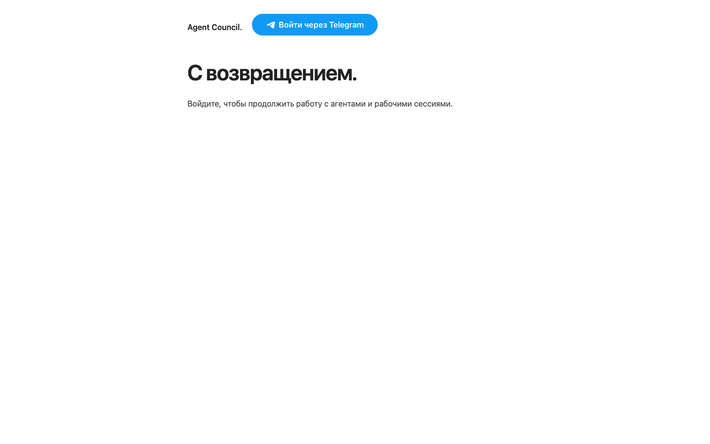

# Agent Council

A platform for managing, coordinating, and monitoring AI agents.

The first integration is a self-hosted Hermes Agent with a web dashboard,
Telegram authentication for an owner and explicitly invited accounts, persistent
storage and Docker Compose.
Code and infrastructure are versioned in
[zavarovkv/agent-council](https://github.com/zavarovkv/agent-council).

This is an early deployment foundation for **trusted operators sharing one Hermes**.
Per-user roles, private user workspaces and isolation between untrusted agents are not implemented. Read
[the architecture](docs/architecture.md) and [security policy](SECURITY.md).

## Deployment

Prerequisites: Linux, Docker Engine 29+, Docker Compose **2.30+**, Bash, OpenSSH
and Python **3.11+** for setup scripts. The current server has Engine 29.9.2 and Compose
5.6.1. The official Hermes **v0.22.5** base image is pinned by SHA-256.

`Dockerfile` adds the owner policy as immutable application code. `compose.yaml`
limits Hermes to one CPU, 2 GiB RAM, 256 processes, bounded logs, a dedicated
bridge network and a loopback port. No host Docker socket or TravelLine
directories are mounted. The official image starts s6 as root and drops the
actual Hermes process to the configured unprivileged UID/GID.

| Item | Server location |
| --- | --- |
| Deployment checkout | `/opt/agent-council` |
| Compose settings | `/etc/agent-council/compose.env` |
| Telegram Client ID / Secret | `/etc/hermes/telegram.env`, root-only |
| Sessions, memory, skills, model login | `/var/lib/agent-council/hermes` → `/opt/data` |
| Agent workspace | `/var/lib/agent-council/workspace` → `/workspace` |
| Nginx virtual host | `/etc/nginx/sites-available/council` |
| Separate HTTPS certificates | `/etc/hermes/letsencrypt` |
| Native profile backup | `/opt/hermes-deploy/docker-migration/hermes-native-before-docker.tar` |
| Retained native profile | `/var/lib/hermes/.hermes` |

GitHub stores source, templates and commit history. Credentials and live data
stay outside the checkout. Container recreation preserves the bind-mounted
state. This persistence is separate from an off-server disaster-recovery backup.

The existing TravelLine Dashboard at `https://2.29.13.129/` is independent.
Hermes is available at **https://council.zavarov.com/** through Cloudflare,
with a separate origin certificate. The initial `sslip.io` hostname redirects
to the custom domain.

## Initial migration

These scripts target the current Ubuntu server and are one-time operational
tools, not a generic installer or an update command:

1. `scripts/install-docker.sh` installs Docker from its signed official apt
   repository without upgrading unrelated packages.
2. Build with `bash scripts/compose-server.sh build` from the server checkout.
3. `scripts/stage-docker.sh` starts a copied profile on `127.0.0.1:19119`.
4. `scripts/migrate-to-docker.sh` stops only native Hermes, takes a consistent
   profile/workspace backup, starts Compose on `127.0.0.1:9119`, verifies data
   across a container restart and disables the old Hermes unit. A failed
   cutover restores native Hermes.

The migration refuses to overwrite an existing production data directory.
The stopped native profile is preserved. See
[the native deployment record](docs/native-deployment.md) for its setup details.

## Telegram sign-in

In `@BotFather`, choose or create a bot and open **Login Widget**. Register the
current public origin and its `/auth/callback` URL:

```text
https://council.zavarov.com
https://council.zavarov.com/login
https://council.zavarov.com/auth/callback
```

Register `/login` as well: the official JavaScript SDK uses the current page
URL when opening its popup. The OIDC fallback uses `/auth/callback`.

From the project on your Mac, run:

```bash
bash scripts/setup-telegram.sh
```

Enter the Login Widget **Client ID** and **Client Secret** in the SSH terminal.
The secret is hidden and saved directly on the server. The Bot API token is
a different credential. The script recreates Hermes to load the environment,
checks its auth gate, then removes the setup-status page.

Explicitly configure the owner: a numeric `HERMES_TELEGRAM_ALLOWED_ID` is
preferred, or `HERMES_TELEGRAM_OWNER_USERNAME` can bootstrap the first login.
The current deployment uses `@zavarov`; a new installation has **no default
owner**. Hermes verifies the OIDC signature, issuer, audience and expiry before the owner policy pins the
numeric Telegram ID. Later logins require that ID even after a username change
or reassignment. Corrupted identity state denies access. Alternative dashboard
providers are disabled. Until configured, the dashboard remains locked.

### Add or remove people

From this project on your Mac, replace `123456789` with the person's numeric
Telegram account ID:

```bash
bash scripts/telegram-access.sh list
bash scripts/telegram-access.sh add 123456789
bash scripts/telegram-access.sh remove 123456789
```

One bot serves all invited accounts. The command stores invited IDs in
`HERMES_TELEGRAM_ALLOWED_IDS` in `/etc/hermes/telegram.env` on the server, outside
Git. The owner is configured separately and remains authorized. Each change
recreates only Hermes to apply the list and close existing connections; valid
tokens for removed accounts are then rejected. Credentials and agent state are
preserved. A failed restart restores the previous settings.

For manual administration, the same setting is a comma-separated list, for
example `HERMES_TELEGRAM_ALLOWED_IDS=123456789,987654321`; apply it by recreating
the Hermes service. Do not put real authentication files in Git or share them.
Invited accounts have the same dashboard/tools/history access as the owner;
these are trusted collaborators, not isolated tenants.

No bot application needs to run. Each independent direct-Telegram installation
registers its own Login client. Standard OIDC and optional centralized login are
[optional future architecture](docs/authentication-options.md), not implemented features.
Never distribute a shared Telegram secret inside an image.

## ChatGPT / Codex account

From the project on your Mac:

```bash
bash scripts/setup-model.sh
```

Select **ChatGPT or Codex Subscription**, open the OpenAI URL in your own
browser, confirm the code and choose an available model. The command runs
inside the container as Hermes; credentials persist in `/opt/data`, outside
GitHub. If device-code sign-in is disabled, enable it in ChatGPT security or
workspace settings, or use Hermes' browser flow. A real response can only be
verified after this user-controlled login.

## Login appearance

The landing page uses [Beauty.css](https://github.com/zavarovkv/beauty-css) as an
exact npm dependency, currently **0.3.0**. `package-lock.json` records registry
integrity. A digest-pinned Node 24 build stage runs `npm ci --ignore-scripts`;
only the CSS, package metadata and MIT license enter the final Hermes image.
The build stage adds no Node runtime to the final image; Hermes retains the
tools supplied by its upstream image. Beauty source is not copied into this
repository. Page-specific overrides live in `assets/login/login.css`.

Dependabot proposes npm updates weekly. An update requires passing checks,
review, image rebuild and deployment; changing the Beauty repository does not
silently change production. To update manually, run `npm install --save-exact
beauty-css@VERSION --ignore-scripts` and commit both package files.

The header uses the **official Telegram Login JavaScript SDK and its default
blue web button**, loaded from `https://oauth.telegram.org/js/telegram-login.js?6`.
The SDK supplies the button styles and icon; Council does not override them.
It opens Telegram's popup. The local initializer in `assets/login/telegram-widget.js`
posts the resulting ID token to the server; it does not trust decoded browser
claims or persist tokens in browser storage. A server-side OIDC/PKCE link stays
available if the SDK cannot load. The page has no footer and supports system
light/dark colors, mobile layout and keyboard focus.

The widget bridge uses same-origin HTTPS POSTs, a short-lived single-use nonce,
a hardened browser cookie, bounded rate/capacity limits, real JWT verification
and the same owner/invitation policy as other sessions. It creates standard
Hermes HttpOnly/Secure session cookies. Widget sessions have no refresh token;
the user signs in again when the signed token expires. Challenges are process-local;
the current container runs one backend. Multiple workers need a shared challenge store.

Landing HTML/CSS/initializer are in `assets/login/` and ship in the Docker image.
`scripts/install-login-theme.py` verifies the pinned Hermes renderer and auth
router before installing templates and the two widget bootstrap routes. Token
verification and session cookie primitives come from Hermes. Updating Hermes
requires a compatibility review.



The dark mobile layout is shown in [this screenshot](docs/screenshots/login-mobile-dark.png).

## Operations

On the server:

```bash
cd /opt/agent-council
bash scripts/compose-server.sh ps
bash scripts/compose-server.sh logs --tail 100 hermes
bash scripts/compose-server.sh restart hermes
```

After reviewing and testing an update:

```bash
git pull --ff-only
bash scripts/compose-server.sh build
bash scripts/compose-server.sh up -d --wait
```

Back up the data directory, workspace and root-only configuration before
upgrades. Stop only Hermes while copying its data for consistent SQLite
backups, then start it again. Keep backups outside the checkout. To roll back
the initial migration, stop Compose and enable/start `hermes-dashboard.service`.
Back up any new Docker state before rollback to preserve post-cutover logins
and sessions.

When upgrading from the initial quoted authentication env file, first run
`python3 scripts/migrate-auth-environment.py` as root on the server, **before**
recreating a container with this version of Compose. It preserves a root-only
backup and writes literal raw values. The `.env.format` marker makes repeat
runs safe. Keep a copy of the previous checkout/image and restore the previous
env file together if rolling back across this format change. In raw env files,
quotes are part of the value; do not add shell-style quoting.

The `hermes-cert-renew.timer` uses the pinned maintenance-only Certbot container.
It mounts only this deployment's ACME directories. It has no access to the
existing application's virtual environment. The renewal script validates and
gracefully reloads Nginx only when a certificate changes. On the server, check
renewal with `bash scripts/renew-certificates.sh --dry-run`.

## Custom domain

Cloudflare has `A council → 2.29.13.129` with proxying enabled. The HTTP-01
challenge works through the proxy, and the origin has a valid Let's Encrypt
certificate. Keep Cloudflare's connection to the origin encrypted; use Full
(strict) mode for this hostname. The one-time switch is recorded in
`scripts/activate-council.sh`, which has a configuration rollback. Both Nginx
virtual hosts keep their challenge routes for renewal. The existing TravelLine
virtual host remains unchanged.

## Development

`src/telegram_auth/` contains the owner policy; `config/` and `scripts/` contain
infrastructure and maintenance commands; `tests/` contains security checks;
`assets/` contains the setup page. Local tests require Python **3.11+** and the
standard library. The YAML profile helper runs inside the image.

Frontend development uses Node **24** and `npm ci --ignore-scripts`. Run
`npm run check` for JavaScript syntax. After `make test-integration`, run
`npx playwright install chromium` and `make test-browser`. Browser tests load
the actual public Telegram SDK, with a fake provider popup and fake backend;
no account credentials or real login are used. CI installs the required browser.

```bash
python3 -m venv .venv
.venv/bin/python -m pip install -r requirements-dev.txt
make test
make lint RUFF=.venv/bin/ruff
make test-integration  # requires Docker; pulls the pinned Hermes image
```

Live checks require outbound HTTPS:

```bash
HERMES_LIVE_URL=https://council.zavarov.com make test
# On the origin server, test origin auth independently of Cloudflare filtering:
HERMES_LIVE_URL=https://council.zavarov.com HERMES_LIVE_ORIGIN_IP=127.0.0.1 make test
```

The optional origin IP changes only routing; TLS still verifies the public
hostname. A Cloudflare rejection is not evidence that application auth works.

GitHub Actions runs Python 3.11/3.14 tests, Ruff, ShellCheck, actionlint,
Dockerfile checks, real Compose credential parsing and offline RSA/JWT tests
against the pinned Hermes adapter. It does not receive server/account secrets or deploy
automatically. Never print production `docker compose config`; use `--quiet`.

See [CONTRIBUTING.md](CONTRIBUTING.md) for contributions and
[the technical review](docs/technical-review.md) for findings and remaining work.
The project's source license is awaiting the owner's selection. Public source
availability alone does not grant an open-source license. Hermes and container
dependencies retain their own licenses.

## References

- [Hermes Docker](https://hermes-agent.nousresearch.com/docs/user-guide/docker)
- [Telegram Login](https://core.telegram.org/bots/telegram-login)
- [Hermes model setup](https://hermes-agent.nousresearch.com/docs/getting-started/quickstart)
- [Sign in with ChatGPT](https://learn.chatgpt.com/docs/sign-in-with-chatgpt)
