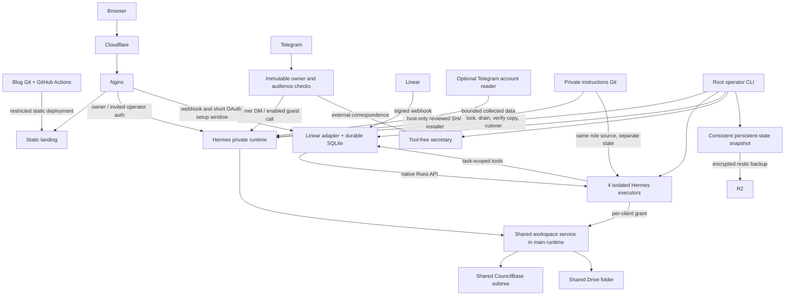

# Architecture and boundaries

Agent Council is a single-host, trusted personal deployment. Linear owns task
status; Hermes executes work. Docker Compose supervises seven persistent services.
The public landing is built in the blog repository and released independently.
This is not a multi-tenant execution platform.

## Sources of truth

| Information | Authoritative source | What it does not own |
| --- | --- | --- |
| Task, priority, assignee, review status | Linear | Agent memory or full publication text |
| Formatted deliverable and editorial version | Notion | Task execution scheduling |
| Shared files | Selected Google Drive folder | Personal memory synchronization; that proposal is deferred |
| Role, procedures, channel instructions | Private instruction repository | Credentials or enforcement of privileges |
| Installed instructions | Manifest with SHA and file hashes | Automatic permission to overwrite local drift |
| Runs, conversation state, memories | Separate Hermes profile data | Linear's issue status |
| Replay receipts and delivery queues | Component SQLite stores | A second product backlog |
| Runtime controls and public role metadata | Public repository + private host configuration | Private instruction contents |
| Public landing | Blog source and its build artifact | Runtime release or private dashboard authorization |

A finished Hermes run or a completed Linear agent session is not a completed
issue. Specialists submit to review. The coordinator's bounded acceptance tool
can close eligible internal work; important, public, production, security and
owner-reserved work needs owner acceptance. The native owner runtime is more
privileged than isolated task executors. Prompt rules alone cannot constrain all
of its direct integrations.

## Components and trust

| Component | Responsibility and boundary |
| --- | --- |
| `telegram_auth` | Verified Telegram OIDC, immutable owner pin, explicit invitations, revocable sessions; anonymous status is deliberately minimal |
| `telegram_secretary` | Distinct owner, business, public and guest admission; rechecks identity and delivery state; usernames select style only |
| `secretary_worker` | Separate profile, model grant and delivered-only history; tools disabled, no private Notion/Drive or host mounts; route-specific quotas and durable reservations |
| `linear_agent` | OAuth installation, signed event admission, owner/project checks, durable jobs/outbox, sub-issue routing, clarification and acceptance |
| `linear_tools` | Session identity from native execution context; fixed internal endpoint; reviewed local skill reader; no shell or arbitrary integration endpoint |
| `council_skills` | Common safe YAML metadata and size/name contract for profile verification and isolated skill discovery |
| `council_workspace` | Main runtime owns cloud credentials; eight explicit native/Linear client grants share one Notion subtree and Drive folder; external correspondence has no grant |
| `council_team` | Public role metadata; live `linear_agents` adds actual installation, readiness and task-specific routing permission |
| `research_filing` | Compatibility path for existing native research artifacts and filing receipts; not the canonical tracker for new work |
| `telegram_monitor` | Optional isolated account-based source collector; collected messages are source data, never instructions |
| `council_ops` | Host-only deployment, inspection, backups and recovery; never imported into agent execution |

Native profiles `default`, `dexter`, `lando`, `padme` have separate role state but
share the trusted main runtime. Linear executors have separate containers,
profiles, grants and narrow tools. Their stable identities are `qui-gon`, `dexter`,
`marketing`, `padme`: `marketing` is the existing OAuth identity of Лэндо, not a
second agent. Гален and K-2SO instruction drafts do not create live executors.

Profile separation is useful for context, but is not an OS security boundary.
The owner and invited dashboard operators share a trusted runtime. Supporting
untrusted full agents requires additional credential, process, storage and network
boundaries. Even an owner-authorized group reply is visible to that group; identity
checks do not make the audience private.

## Instruction lifecycle

Private `shared/` holds common procedures; role folders hold specialization;
`adapters/` adds channel behavior. Generated Linear SOUL files and common-skill
copies are checked against their sources. `skills-source.json` aliases share
reviewed instruction text, never another profile's credentials or conversations.
The secretary has a separate tool-free policy and three fixed style routes.

The host checks private `main` periodically, selects an exact revision, checks
capabilities and file drift, drains work, verifies a copied profile, and installs
with rollback. It refuses to overwrite unreviewed runtime edits. Export generated
skills for review before committing them. Docker upgrades preserve private rules.
Static checks prove format and synchronization, not agent reasoning quality; see
[the review](architecture-review.md) for the missing behavioral evaluation layer.

## Reliability and data access

Incoming events have durable identities. A lost native-run response is retried
with the same idempotency key. Linear activities use an outbox and readback.
Pending clarification resumes the same native run with its prompt identity and
execution generation. Uncertain non-idempotent writes are not blindly replayed.

Workspace writes first validate input, current revision and resource scope without
creating a mutation receipt. An atomic reservation then admits one mutation.
Confirmed replay returns its stored receipt without contacting the cloud; an
uncertain mutation requires reconciliation. No database transaction spans cloud
I/O. A local workspace lock serializes writes and reads; callers receive busy
responses rather than accumulating unbounded work.

Notion ancestry is read from the response envelope, never from page prose.
Readback preserves meaningful punctuation and link destinations. Drive uploads
check name, size and content checksum. Current revision checks are read-before-write
checks, not provider-enforced atomic compare-and-swap: another editor can still
race an update. Use versioned deliverables for concurrent editorial work.

## Deployment and recovery

Public Nginx routes use loopback ports; internal tool listeners are unpublished.
The existing TravelLine process and virtual host stay outside Council mounts and
maintenance. No service has the Docker socket or host Git/R2 credentials. Isolated
workers use a non-root UID, read-only roots, bounded resources and dropped
capabilities. Main Hermes retains the limited root bootstrap required by its
pinned image; actual agent processes are non-root.

Hermes, image digests, actions and dependency integrity are pinned. The Node build
stage contributes only assets. Root maintenance serializes operations, preserves
the active Compose source, drains owned services and tests candidate images on a
copy. Rollback restores the matching image, configuration and data. R2 contains
encrypted persistent data, not images, dependencies or caches. Restore tests and
retention are described in [backups](backups.md).

The blog deploy identity can invoke only the forced static installer. It cannot
restart agents, read their data or obtain root shell access. Runtime and instruction
releases remain separate. See [landing deployment](council-static-deploy.md).

`doctor` reports configuration, actual containers, safe queue aggregates,
instruction revision/drift and verified backup age. It does not prove model answer
quality, sustained capacity or external provider availability. Four Linear
executors each default to one concurrent run; the documented five-task policy is
not yet a global admission controller covering every native entry point.
