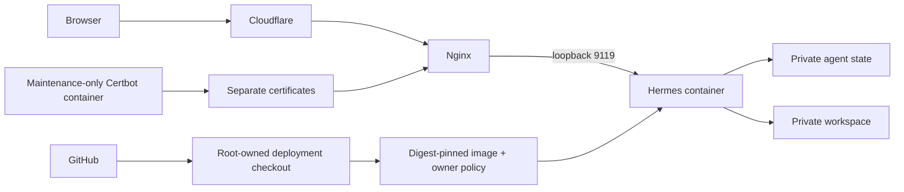

# Architecture and scope

Agent Council is an early foundation for agent management. The current code
provides one Hermes integration and deployment tooling. It does not yet include
a multi-agent scheduler, tenant isolation, billing or a separate control plane.

The existing TravelLine process, virtual environment and Nginx virtual host
are separate. They are not mounted into Hermes. The agent process runs as an
unprivileged user; the image's s6 supervisor has the limited bootstrap rights
documented in Compose. The host Docker socket is never mounted into the agent.

Telegram's OIDC protocol implementation comes from the pinned Hermes release.
The project adds owner authorization after token verification. Prefer a numeric
owner ID in root-owned settings. A username may bootstrap enrollment, after
which the profile stores the immutable ID. Profile/plugin execution belongs to
the same trusted-owner boundary; see SECURITY.md before expanding the system
to untrusted agents or multiple users.

Model credentials and user state belong to the private data volume. They do
not belong in an image, a source checkout or GitHub Actions. The deployment
environment determines the public URL; no repository account is implicitly
granted access to a new installation.

Generic OIDC and an optional shared identity service are proposed in
[authentication-options.md](authentication-options.md). They are not yet part
of the deployed authentication flow.
