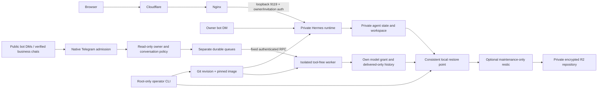

# Architecture and scope

Agent Council currently manages a single trusted Hermes runtime and an optional,
isolated secretary. Docker Compose is the single-host process supervisor; the
root-owned operator CLI handles release and recovery operations. This is a
modular application with explicit execution boundaries, not a multi-tenant agent
platform. A separate scheduler or control plane is not implemented.

## Code boundaries

| Component | Responsibility | Dependencies and limits |
| --- | --- | --- |
| `src/telegram_auth/` | Verified Telegram login, owner enrollment, invitations, revocable dashboard sessions | Pinned Hermes OIDC/JWT/cookie primitives; never trust browser-decoded claims |
| `telegram_secretary/plugin.py` | Native SDK admission and component wiring | Owns handler order and startup tasks; foreign updates stop before private handlers |
| `telegram_secretary/policy.py` | Read the owner pin and literal deployment settings once | Standard library only; usernames select style, never privileges |
| `telegram_secretary/bridge.py`, `public.py` | Business and public bot transports | Independent transports share delivery; a public send cannot become a business send |
| `telegram_secretary/delivery.py`, `store.py` | Per-chat serialization, cancellation, delivery ambiguity and queue state | Recheck work before model spend and before sending; no private agent executor |
| `telegram_secretary/rpc.py` | Fixed worker endpoint and authenticated JSON exchange | No caller-selected URL, redirects or inherited proxies |
| `secretary_worker/protocol.py` | Strict input schema and conversation namespace | Opaque identifiers, bounded text, fixed audience enumeration |
| `secretary_worker/service.py` | Compose history, skill instructions and model generation | No Telegram credential, private tools, agent executor or caller prompts |
| `secretary_worker/history.py` | Transactional reservations, quotas, delivered context and retention | Existing SQLite schema; committed request identity prevents repeated generation |
| `secretary_worker/http.py` | Bounded private HTTP transport | Machine key, finite sockets/threads, bounded request body and generic errors |
| `secretary_worker/model.py` | Pinned Hermes auxiliary model adapter | Separate provider grant, `tools=None`, final text only; reject tool calls/reasoning-only results |
| `src/council_ops/` | Host install, build, backup, restore and inspection | Not copied into the runtime image; root-only settings and serialized maintenance |
| `assets/login/`, `instructions/` | Versioned login assets and role instructions | Immutable image artifacts; exact unchanged Beauty.css dependency |

Static import checks enforce the worker's narrow upstream adapter dependency and
prevent the gateway from importing the worker or host operations. These checks
are maintenance guardrails; container isolation and application authorization are
the actual execution boundaries. Runtime tests exercise the real pinned SDK
rather than treating import checks as a security proof.

## Identity and conversation routing

Telegram verifies the OIDC token before owner enrollment. A verified owner login
pins its numeric ID whether setup used an explicit ID or username bootstrap.
Existing pins must agree with explicit configuration. Invited accounts are
independent numeric grants and cannot create or replace the owner pin.
Dashboard sessions store only token hashes and verified identity metadata;
revocation, expiry and invitation checks remain effective after a restart.

The owner bot DM uses the private agent. Other bot DMs use the optional public
transport. Business messages additionally require a fresh, enabled connection
owned by the pinned account with reply permission. Each route has its own queue
and conversation namespace. Public and business routes share two generation
slots, while the worker separately enforces capacity and hourly quotas.

`spouse`, `contacts` and `new-users` are conversation styles with the same
restricted capabilities. The spouse username preference is not proof of family
identity or an access grant. The bot API does not supply the owner's address-book
membership; contacts use an explicit private ID list. Rules and their editing
workflow are documented in [secretary.md](secretary.md).

Cancelled, edited, expired or human-paused work is checked again after waiting
for capacity. Local start/help messages do not call the model or acknowledge
nonexistent model history. Only a confirmed generated reply is acknowledged as
delivered. Ambiguous Telegram sends never replay automatically. Cancellation
cleans up the in-memory task and pending claim. This is not exactly-once delivery:
an interrupted or failed generation can require a new incoming message.

## Deployment and persistent state

The existing TravelLine process, environment and virtual host are separate and
never mounted into a Council container. Nginx routes only the new virtual host to
loopback. Certificate maintenance uses separate directories. The image's s6
bootstrap needs limited root capabilities and a writable root; actual agent
processes run under the dedicated non-root UID/GID. The worker has a read-only
root, no capabilities, no published ports and only its own profile mounted.
Neither service receives a Docker socket or operator/R2 credentials.

Images pin upstream digests and dependency integrity; releases use Git revision
labels/tags. The same pinned Hermes base preserves its runtime tools and provider
adapter compatibility. Node is a build stage, with only dependency artifacts
copied into the final image. Runtime data and generated skills remain outside Git.

The operator CLI serializes account setup and maintenance, builds before downtime,
checks idle work, stops the two owned services consistently, and tests both old
and candidate images against copied state without network access. Failed cutover
restores image, data, auth, machine key and active Compose source together. The
active Compose source lives outside the checkout, so updating Git does not change
the previous release's rollback configuration. Legacy migration commands require
an explicit opt-in and are not an update workflow.

`doctor` reports actual container controls, the loaded secretary policy and both
queues' availability/counts, without identities, transcripts or keys. Optional
route faults remain visible without preventing repair/restore. Health and queue
inspection do not prove that an external model grant remains valid.

## Recovery and scope limits

Local upgrade restore points retain complete state. Optional R2/restic backups
contain encrypted persistent data and exclude regenerable software, caches,
logs and images. Recovery downloads and offline database checks precede retention.
Installing tooling does not activate cloud backups: credentials, initialization,
a verified recovery and explicit scheduling are required. See [backups.md](backups.md).

The owner and invited dashboard operators share a trusted runtime, credentials
and tools. They are not separate tenants. The tool-free secretary is the only
supported path for untrusted correspondence; it cannot read private Notion/Drive
data or run internal research agents. General guest agents require a separate
control plane and execution/storage/credential isolation. Groups, proactive
messaging, personal-account clients and phone escalation are not enabled by this
architecture. See [SECURITY.md](../SECURITY.md) for the supported threat model.
