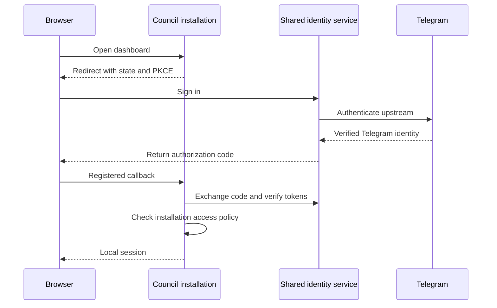

# Authentication direction

Status: proposed architecture, not implemented. The current deployment supports
direct Telegram login for an owner and a numeric allowlist of trusted collaborators.
This direct mode is the preferred simple setup for the current deployment;
no separate identity server is needed. The broker below is an optional future
architecture for deployments that need it.

Agent Council should use standard OpenID Connect (OIDC) for application login,
with an optional shared identity service. Operators should be able to choose:

| Mode | Operator setup | Dependency |
| --- | --- | --- |
| Shared Council identity service | Register the installation and its exact HTTPS callback | Council-operated login service |
| Bring your own OIDC | Configure issuer, per-installation client and allowed owner/group | Operator's chosen identity provider |
| Direct Telegram | Register a Login client in BotFather | Telegram; no Council-operated service |

No Telegram bot program has to run for website login. The current direct mode
uses Telegram's Login client ID and secret, not a running bot application.

The shared service keeps the upstream Telegram credential. Every installation
gets its own client registration, exact callback allowlist and token audience.
Never ship a shared secret in a public image. Identify OIDC accounts by the
verified issuer and subject, not by a username or unverified email. Authentication
does not grant access to every Council installation: each deployment must
explicitly authorize its owners or groups.

Authentik is a candidate because it provides both Telegram social login and
OIDC application providers. Keycloak supports OIDC identity brokering as an
alternative. Evaluate the actual Telegram flow, account linking, recovery,
logout and claim mapping before choosing and deploying either product. Do not
write a custom token issuer just to avoid configuring an identity server.

For third-party installations, require proof of domain/control before enabling
redirects. Automated client onboarding may follow later; never accept arbitrary
callback URLs or unrestricted wildcard redirects. Use separate credentials for
each installation and permit independent revocation.

The shared service introduces an availability and trust dependency. Keep it
outside agent execution containers, back up its database and signing keys,
provide an operator recovery path, and document what happens when it is down.
BYO OIDC keeps independent deployments independent. Separate control-plane
authorization and per-agent execution/storage boundaries are still required
before supporting mutually untrusted users and agents.

References:

- [Telegram Login](https://core.telegram.org/bots/telegram-login)
- [Authentik Telegram support](https://docs.goauthentik.io/releases/2025.10)
- [Authentik OIDC providers and sources](https://docs.goauthentik.io/add-secure-apps/providers/oauth2)
- [Keycloak identity brokering](https://www.keycloak.org/docs/latest/server_admin/)
