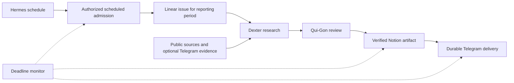

# Recurring jobs: incident review and proposed design

Reviewed on 2026-11-02, shortly after 02:30 Europe/Moscow. The missed morning
edition investigated here is **2026-11-01**. This is a read-only production
investigation and a design proposal; schedules, grants and services were not
changed, and no research or messages were triggered during the review.

## Where to manage jobs now

The installed dashboard exposes **Cron** at
`https://council.zavarov.com/cron?profile=default`, behind the existing sign-in
gate. The main profile currently holds the two travel jobs. The native `/cron
list` command also lists jobs in the bot conversation.

The main Telegram profile selects the `cronjob` toolset. Its
`cronjob_manage` tool supports list, create, update, pause, resume, remove and
manual run; managing a schedule does not require editing `config.yaml`.
The gateway liveness probe passed and cron storage was writable at inspection.
This verifies management prerequisites, not a successful future research run.

After a requested change, Qui-Gon should read the saved job back and report the
name, schedule in Moscow time, next occurrence and destination. Before updating,
list jobs and reuse their real IDs. Enabling or editing a schedule is distinct
from verifying its full workflow. A test run spends tokens and may deliver a
message; this investigation did not trigger one.

## What happened

The scheduler fired both configured jobs on time. Execution failed before a
reviewed report existed; the failure was not a missed cron tick.

| Event on November 1, Moscow time | Evidence |
| --- | --- |
| 07:20:24 | `council-travel-research` started, about 25 seconds after its scheduled time |
| 07:28:38 | Research execution ended as `failed`; no Dexter task/run was created |
| 08:00:24 | `council-travel-delivery` started on schedule |
| 08:01:24 | Delivery-phase execution ended as `failed`; native delivery recorded a failure notification as `delivered` |

These times come from the execution ledger and job dispatch receipts, not the
agent's narrative. A native `delivered` outcome is not proof that the owner read
the notification. There is no successful report delivery receipt for this edition.

The research transcript contains these concrete failures:

- `hermes kanban --help` returned `command not found` in the terminal tool.
- `python3 -m hermes_cli.main kanban --help` reported that no dependency
  environment was committed for that installation.
- A persisted launcher under the profile's `installs/` directory referenced a
  Python interpreter under the former host path `/var/lib/hermes/.hermes/`,
  which was unavailable inside the container.
- Generic Python execution required approval unavailable in an unattended run.
  Disabling that guard is not the proposed repair.
- A diagnostic write under `/workspace/research/` was outside the configured
  safe write root. The agent subsequently saved its blocked-run record under
  `/opt/data/research/` instead. This was secondary to the failed delegation.

The agent performed some public-source checks, but that did not produce a
reviewed Dexter artifact eligible for the old `research_archive` path.

The optional Telegram source was also not configured: its runtime metadata,
current evidence, host credential file and active collector timer were absent.
This explains missing Telegram coverage; it should not prevent a clearly marked
public-source report. Notion access was not the recorded blocking step.

## Current consistency problems

At review time, the installed `travel-digest` skill requires Linear-owned work.
The two persisted cron prompts still require the native Hermes research board
and `research_archive`. Updating a skill did not migrate those saved prompts.
The repository's [architecture](architecture.md) calls native research filing a
compatibility path, while [Telegram monitoring](telegram-monitor.md) still directs
new setup through that path. This is a current inconsistency, not proof that the
same skill version was installed at the time of the morning failure.

The existing `linear_tools` grant is bound to an authorized Linear execution
session. A plain cron session does not automatically acquire that identity.
Changing the prompt to say "use Linear" is therefore insufficient: the scheduled
entry into the adapter must be implemented and verified.

The host monitor checks process health and pending research filing, but has no
check that an expected daily report exists and was delivered by its deadline.
An empty filing queue looks healthy even when research never started. The native
cron incident was recorded and a failure notification was marked delivered, but
there is no recorded recovery run for this edition. Both jobs remain enabled;
their next scheduled starts are November 2 at 07:20 and 08:00 Moscow. Readiness
for that next edition has not been established by this investigation.

## Proposed responsibilities

Keep the existing single-host architecture. Extend the current adapter and
monitoring rather than introduce another task tracker or a digest-specific daemon.

- **Hermes** owns schedule firing, model execution and its native execution and
  delivery receipts. Agents interpret requests, research and synthesize.
- **Linear** owns the task, responsible agent, review and actionable blockers.
  Use the current acceptance policy: specialists submit for review; Qui-Gon can
  accept eligible internal research; owner-reserved work remains for the owner.
- **Notion** owns the formatted report and reviewed version; Drive holds shared
  supporting files when needed.
- **The existing adapter** admits each authorized recurring request once and
  correlates the schedule occurrence, issue, agent runs and artifact receipts.
- **The existing host monitor** checks expected outcomes independently of the
  agent and raises one actionable incident when a deadline is missed.

The scheduled-admission capability must bind to a previously authorized job,
owner, team/project and allowed executor. It must not forge a Linear session,
reuse executor credentials outside their scope, or require a new owner mention
each morning. The main assistant can configure a recurring request through this
narrow capability once it exists.

## Contract for every recurring job

Keep one versioned definition: job identity, reporting timezone/window, cadence,
preparation time, delivery deadline, responsible agent, source policy, artifact
destination, delivery target, retry/runtime/token limits and skill references.
Keep private IDs and destinations in private configuration. Store the accepted
definition and skill revision with each occurrence; avoid full workflow copies
in cron prompts. Changes must reconcile existing schedules, not create duplicates.

Give each occurrence a stable identity such as `travel-digest:2026-11-01`, where
the date is the agreed reporting date in Europe/Moscow. Retries reuse it. Changing
the definition during recovery must not silently create a second issue/report.

Persist technical stage receipts separately from human issue status:

`admitted → researching → reviewing → artifact_verified → delivery_pending → delivered`

Each stage has a bounded deadline, attempt count, correlation IDs and a confirmed
result. Failure records identify the failed stage, retry eligibility and next
owner/action. This is execution bookkeeping, not another product backlog.

Do not rely on a model saying "saved" or "sent". Require the Notion write/readback
receipt and the native delivery outcome. Reuse confirmed receipts on restart.
Do not blindly repeat an uncertain external create/send: reconcile its outcome
or raise an explicit incident, since Telegram does not provide end-to-end
exactly-once delivery for an ambiguous send response.

Preparation and delivery are separate concerns. If delivery is due at 08:00,
prepare and verify the artifact before that time. Starting another research-capable
LLM turn at 08:00 cannot guarantee an 08:00 message. At the deadline send either
the prepared summary/link or a short failure status with the next action. A later
recovery may deliver the report once, clearly marked as delayed.

`context_from` can supply prior output, including failure output; it is not proof
that upstream work finished successfully for the current reporting window. Gate
delivery on the occurrence's verified artifact, not merely the newest text file.

Retry transient network/provider failures with bounded backoff. Missing tools,
invalid grants and incompatible workflow versions require repair, not repeated
model investigation. Preserve successful earlier stages when retrying later ones.
Missing optional Telegram coverage must be disclosed, not interpreted as no news.

## Implementation and acceptance order

1. **Repair deployment consistency.** Verify supported CLI/tool execution inside
   the actual unattended runtime. Rebuild launchers/dependencies in the image;
   preserve data rather than reuse host-specific virtual environments. Check the
   supported safe output directory without weakening unattended approval policy.
2. **Connect scheduling to the canonical task flow.** Add authorized, idempotent
   scheduled admission to the existing Linear adapter. Verify delegation to the
   real Dexter executor and resume through existing callbacks/outboxes.
3. **Migrate existing definitions.** Reconcile the two current jobs, installed
   workflow and setup documentation. Preserve IDs/history and ensure no duplicate
   scheduler remains active. Add a compatibility check for installed skill/tool
   contracts before a schedule can be reported ready.
4. **Verify artifacts and delivery.** Use the shared workspace Notion grant and
   current-period readback. Connect readiness to durable delivery without a second
   manual sender. Define partial coverage and late-report behavior explicitly.
5. **Monitor the expected edition.** Extend `doctor`/monitor with the last expected
   occurrence, stage, age, deadline and delivery outcome. The watchdog should use
   fixed code, not an LLM, and remain useful when the research worker fails.
6. **Exercise the whole path.** Test against the pinned image with a disposable
   profile and fake providers first; then verify an authorized real edition.

Required integration cases: cron-only startup, fresh session with no chat context,
duplicate ticks/admissions, restart after task creation, unavailable executor,
missing optional source, stale upstream artifact, Notion timeout after a write,
Telegram failure/uncertain send, exhausted budget, deadline overrun, skill update
with an incompatible persisted job and owner-reserved review. Prove one occurrence
does not duplicate the task or known completed effects, and a failed one cannot
silently disappear. Do not label scheduling ready based only on healthy containers.

## References and evidence scope

Production evidence was read from native cron job metadata, execution/incident
and delivery SQLite records, the two cron session transcripts, installed skill
text and collector configuration presence. Private transcripts and credentials
are not copied into this document. Current code references:
[Linear tool identity](../src/linear_tools/__init__.py),
[monitoring](../src/council_ops/monitoring.py),
[research compatibility workflow](research.md).

Primary guidance:
[Hermes scheduled tasks](https://hermes-agent.nousresearch.com/docs/user-guide/features/cron),
[Hermes cron troubleshooting](https://hermes-agent.nousresearch.com/docs/guides/cron-troubleshooting),
[AWS: safe retries with idempotent APIs](https://aws.amazon.com/builders-library/making-retries-safe-with-idempotent-APIs/).
Online documentation informs the proposal; available behavior must be checked
against the deployed pinned release before implementation.
